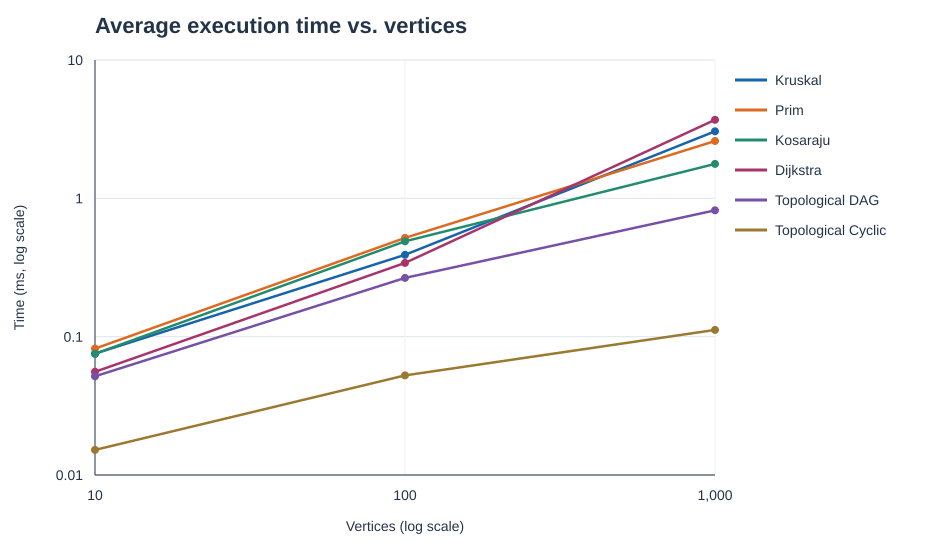
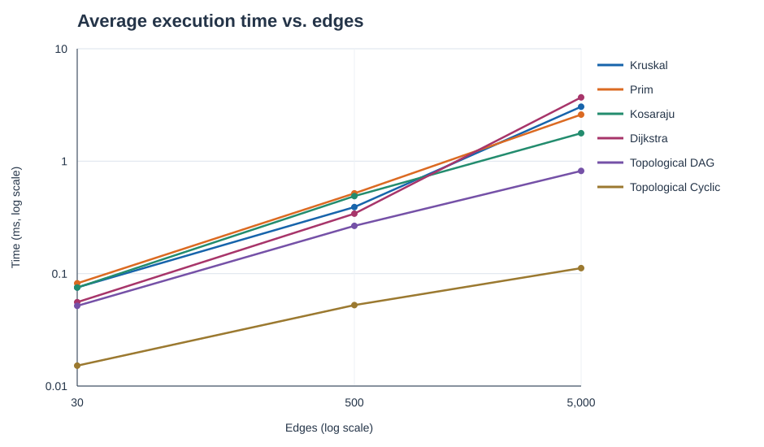

# Assignment 3 - Smart City Infrastructure and Route Planning

## Overview

This Java 17 application represents districts as numbered vertices (`0` to `V-1`). An undirected weighted adjacency-list graph represents two-way roads; a directed adjacency-list graph represents one-way roads or dependencies. Each weighted edge stores a non-negative integer construction cost or travel distance. The same weighted graph supports minimum spanning tree (MST) and shortest-path tasks; a separate directed graph supports topological ordering and strongly connected components (SCCs).

## Build and run

Run from this repository's root directory. A Java 17+ JDK is required. Python 3 is needed only to regenerate the SVG plots; the plotting script uses the standard library.

```powershell
$sources = Get-ChildItem src -Recurse -Filter *.java | ForEach-Object FullName
New-Item -ItemType Directory -Force build | Out-Null
javac -d build $sources
java -cp build Main
java -cp build Tests
java -cp build Benchmark
python scripts/plot_results.py
```

`Benchmark` writes `results/tables/benchmark.csv`; its optional first argument changes that path. The two plots are regenerated from the CSV. On another operating system, compile all files under `src` into `build`, then run the same two Java classes. The checked-in CSV and plots are one measured run, so elapsed times on another computer will differ.

## Implementation

| Task | Algorithm and design |
|---|---|
| MST | Kruskal sorts edges and uses a DSU with path compression and union by size. Prim starts at each unseen vertex and uses a binary-heap priority queue. Both return a minimum spanning **forest** for a disconnected graph and flag `connected=false`; on a connected graph the forest is an MST. |
| Topological ordering | Kahn's algorithm counts indegrees and removes zero-indegree vertices using a priority queue. If fewer than `V` vertices are removed, a cycle exists and no order is returned. |
| SCC | Kosaraju's algorithm uses two iterative DFS passes, with a reversed adjacency list between them. It returns every component as a list of vertex IDs. |
| Shortest paths | Dijkstra uses a binary heap and lazy stale-entry removal. It returns `long` distances, predecessor paths, and `INF`/empty paths for unreachable vertices. The graph rejects negative weights when inserted. |

The MST weight is accumulated in a `long`, and Dijkstra checks for `long` overflow before addition. Equal edge weights may yield different valid MST edge sets, so the correctness comparison uses total weight. In benchmark data, `edge_examinations` counts inspected edges or arcs; `other_operations` counts the algorithm-specific operations described below.

## Complexity analysis

The graph uses adjacency lists and the heaps are binary heaps. `V` is the vertex count and `E` is the number of stored input edges; an undirected edge appears twice in adjacency lists. Runtime bounds assume standard Java library implementations.

| Algorithm | Time | Additional space | Effect of graph size |
|---|---|---|---|
| DSU `find`, `union` | Amortized `O(alpha(V))` per operation with path compression and union by size | `O(V)` | The inverse Ackermann factor grows so slowly that repeated connectivity checks are near constant time. Union by size limits tree depth; compression flattens paths on subsequent finds. |
| Kruskal | `O(E log E + E alpha(V))` | `O(V+E)` | Sorting dominates as edge count grows; DSU processes selected candidates until the tree is complete or edges run out. |
| Prim | `O(E log E)` with this lazy edge heap | `O(V+E)` | Every undirected adjacency arc can enter the heap. A denser graph increases heap work. |
| Kosaraju SCC | `O(V+E)` | `O(V+E)` | Each vertex and directed edge is processed in each DFS pass; building the transpose also traverses all edges. |
| Kahn topological ordering | `O(V+E+V log V)` with a priority queue | `O(V)` beyond the input graph | Indegree calculation scans `E` edges; each vertex enters/leaves the heap once. A FIFO queue would give `O(V+E)` without deterministic smallest-ID tie breaking. |
| Dijkstra | `O((V+E) log E)` with lazy duplicate heap entries | `O(V+E)` | Reachable edges are relaxed once; more edges can create more heap entries. With a decrease-key heap the usual bound is `O((V+E) log V)`. |

Dijkstra's greedy choice is invalid for negative edges: a vertex considered final can later receive a shorter path. The application rejects negative edges. Negative cycles also make finite shortest paths undefined for affected vertices; Bellman-Ford is appropriate when negative edges must be supported.

## Experimental setup

| Size | Vertices | Edges |
|---|---:|---:|
| Small | 10 | 30 |
| Medium | 100 | 500 |
| Large | 1,000 | 5,000 |

`GraphFactory` uses `java.util.Random` with seed `20261019 + V` for each size. It generates exactly `E` distinct, non-self-loop edges. The undirected road graph first adds a random spanning tree, then adds random pairs, so it is connected; weights are uniformly drawn integers from 1 to 100. A directed DAG uses only edges from a smaller to a larger vertex ID. A separate cyclic directed graph starts with `0 -> 1 -> 0` and adds random directed edges, so a cycle is guaranteed. The cyclic graph is used for both SCC and failed topological-order runs. Dijkstra starts at district 0 on the road graph.

For each graph and algorithm, the benchmark runs three unrecorded warm-ups and five recorded runs of the same graph. It times only the algorithm call with `System.nanoTime()` and reports the arithmetic mean. Graph generation, checks, CSV writing, and plotting occur outside timing. Each algorithm returns an operation count from its last recorded run. `Kruskal`'s second count combines sort comparisons and DSU `find` calls; `Prim`'s is heap comparisons; `Dijkstra`'s combines successful relaxations and heap comparisons. These operation categories are useful for tracking growth within an algorithm, but their raw magnitudes do not measure identical work across algorithms. The cyclic topological run can finish early after initial indegree construction, so it may examine fewer than `2E` arcs.

The included run used Microsoft OpenJDK 17.0.20.1 on Windows with an Intel Core i5-13420H (12 logical processors). These are short, single-process timings, so JIT compilation, garbage collection, and background load can affect them. The three sizes also increase `V` and `E` together, so the plots demonstrate scaling along these configurations rather than isolating the independent effect of either variable.

## Results

Average time is in milliseconds. `Edges scanned` and `Other ops` correspond to the operation definitions above. All source measurements are in [benchmark.csv](results/tables/benchmark.csv).

| Algorithm | V | E | Avg ms | Edges scanned | Other ops | Result |
|---|---:|---:|---:|---:|---:|---|
| Kruskal | 10 | 30 | 0.075 | 24 | 196 | MST weight 156 |
| Prim | 10 | 30 | 0.082 | 60 | 489 | MST weight 156 |
| Topological DAG | 10 | 30 | 0.052 | 60 | 0 | DAG |
| Topological cyclic | 10 | 30 | 0.015 | 30 | 0 | Cycle detected |
| Kosaraju | 10 | 30 | 0.075 | 90 | 0 | 1 SCC |
| Dijkstra | 10 | 30 | 0.056 | 60 | 99 | Source 0 |
| Kruskal | 100 | 500 | 0.391 | 309 | 5,001 | MST weight 1,281 |
| Prim | 100 | 500 | 0.517 | 1,000 | 17,314 | MST weight 1,281 |
| Topological DAG | 100 | 500 | 0.266 | 1,000 | 0 | DAG |
| Topological cyclic | 100 | 500 | 0.052 | 502 | 0 | Cycle detected |
| Kosaraju | 100 | 500 | 0.489 | 1,500 | 0 | 3 SCCs |
| Dijkstra | 100 | 500 | 0.341 | 1,000 | 2,393 | Source 0 |
| Kruskal | 1,000 | 5,000 | 3.054 | 3,252 | 62,794 | MST weight 12,753 |
| Prim | 1,000 | 5,000 | 2.599 | 10,000 | 240,820 | MST weight 12,753 |
| Topological DAG | 1,000 | 5,000 | 0.819 | 10,000 | 0 | DAG |
| Topological cyclic | 1,000 | 5,000 | 0.112 | 5,026 | 0 | Cycle detected |
| Kosaraju | 1,000 | 5,000 | 1.773 | 15,000 | 0 | 8 SCCs |
| Dijkstra | 1,000 | 5,000 | 3.697 | 10,000 | 37,174 | Source 0 |





Both axes are logarithmic so all six series are visible. Time values come from the same 18 benchmark rows; changing the horizontal axis does not create an independent experiment.

## Comparison and discussion

Kruskal and Prim returned identical MST weights for all connected cases, as expected. Kruskal was faster in the medium measured run and Prim was faster in the large run, although Prim scanned all `2E` undirected adjacency arcs and made many heap comparisons. Kruskal examined fewer sorted edges before completing the tree, but it had to sort all `E` edges first. These results are specific to the data, implementation, and machine; operation counts make the different work patterns more informative than the sub-millisecond small-case timings.

Kosaraju examined exactly `3E` directed edges: one DFS pass, one transpose construction, and one reverse DFS pass. Its measured time grew from 0.075 ms to 1.773 ms across the sizes. This is consistent with linear work in `V+E`, but timings alone do not prove an asymptotic bound. SCC counts (1, 3, 8) depend on the seeded random graphs.

The DAG topological pass scanned `2E` edges: indegree creation and processing. The cyclic graph was correctly rejected at all three sizes; its early exit explains its lower time. Dijkstra scanned `2E` road arcs and its heap work increased markedly as the graphs grew. Since the road graph is connected, all vertices were reachable in these runs; unreachable behavior is covered by tests.

## Testing

Run `java -cp build Tests`. The suite currently makes 22 assertions and covers a small connected graph with duplicate weights and multiple possible MSTs, a disconnected graph, a single vertex, DSU repeated unions, a DAG's edge-by-edge ordering validity, a graph with multiple SCCs and a cycle, every vertex appearing in exactly one SCC, exact Dijkstra distances and path, an unreachable vertex, and rejection of a negative edge. The benchmark additionally checks that Kruskal and Prim agree on each generated connected graph, every directed edge respects the generated DAG ordering, cyclic inputs are rejected, every vertex belongs to exactly one SCC, and all districts in the connected road graph are reachable from district 0.

## Conclusion

Use Kruskal or Prim to plan a low-cost connected road network; both give the same minimum total cost, and this implementation's Prim performed better on the largest measured graph. Use Kahn's algorithm to order acyclic service dependencies, Kosaraju to identify mutually reachable groups in directed networks, and Dijkstra to plan travel routes with non-negative distances. If roads are disconnected, the MST algorithms report a forest and flag the lack of a citywide connection. If negative route weights are required, use a different shortest-path algorithm.
